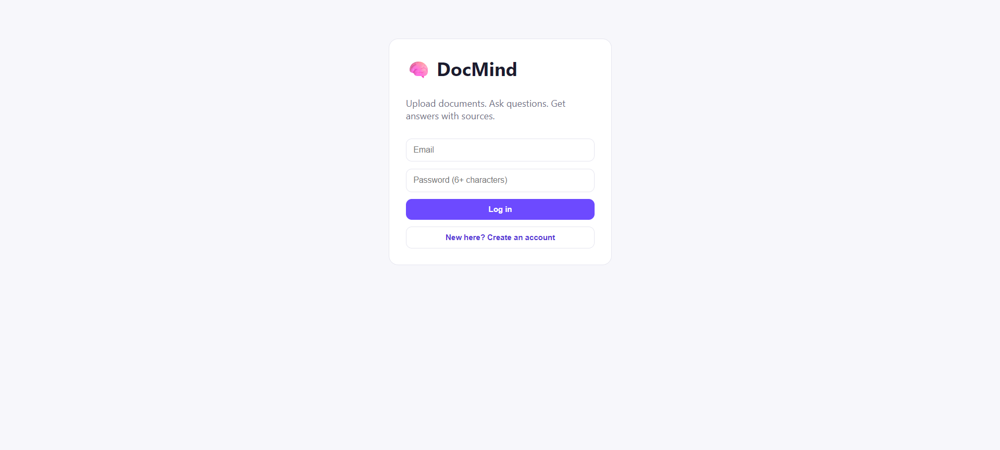
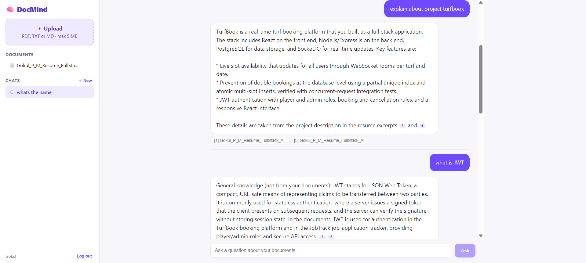
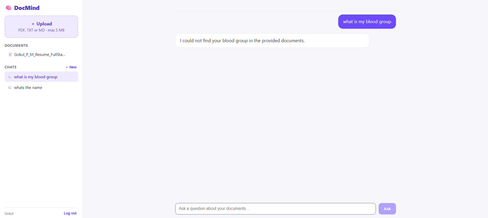

# DocMind – Chat with Your Documents (RAG) · React, Node.js, PostgreSQL, LLM API

Upload PDFs or text files, ask questions in plain English, and get **streamed answers with numbered citations** that link back to the exact passages used. Answers are based on your documents, and anything that is not from them is clearly labelled.

**Live demo:** [docmind-sooty-three.vercel.app](https://docmind-sooty-three.vercel.app) &nbsp;|&nbsp; **API:** [docmind-api-vhb9.onrender.com](https://docmind-api-vhb9.onrender.com/api/health)

> Hosted on free tiers (Vercel, Render and Neon), so the first load after a quiet period can take up to ~30 seconds while the server wakes up.
>
> **Privacy:** this is a public demo. Uploaded documents are stored in the demo database and sent to an AI provider to answer questions, so please do not upload anything private. Use a sample file instead.

## Screenshots

### Login


### Answers with citations
Answers stream in word by word and cite the passages they used (the numbered chips and source labels). Questions that are not about the document, such as "what is JWT", are answered as general knowledge and labelled as such.



### When the document has no answer
If the document does not contain the answer, DocMind says so instead of guessing.



## How it works (RAG pipeline)
1. **Ingest:** text is extracted from the file (pdf-parse), split into overlapping ~900-character chunks at sentence boundaries, and saved in PostgreSQL in one transaction.
2. **Retrieve:** small document sets (up to 8 chunks, such as a resume) are sent to the model in full, so a question never has to share words with the text. Larger sets use PostgreSQL full-text search (`tsvector`, GIN index, `ts_rank_cd`); if that finds nothing, the model rewrites the question into keywords and the search runs again. Everything is scoped to the logged-in user, and optionally to one document.
3. **Generate:** the top chunks and the last few messages are sent to an LLM with instructions to answer only from the excerpts and cite them like `[1]`.
4. **Stream:** the answer is streamed to the browser token by token with server-sent events. Only the excerpts the answer actually cited are kept as sources, so users see real evidence.

## Engineering highlights
- **Streaming end to end:** the backend parses the provider's SSE stream (handling events split across network chunks) and re-streams it; the React client reads it with `fetch` + `ReadableStream`
- **Provider-agnostic:** works with any OpenAI-compatible API (Groq free tier, OpenAI, etc.) via environment variables; a built-in **mock mode** runs with no API key
- **Two answer modes (`ANSWER_MODE`):** `assisted` (default) answers facts only from the documents, gives labelled assessments for opinion questions and labelled general knowledge for questions like "what is JWT"; `grounded` answers strictly from the documents and, if neither search nor keyword rewriting finds anything, replies "not found" **without calling the model**. In both modes the model is told never to invent document details and to ignore instructions found inside documents (prompt-injection mitigation)
- **Cost and abuse protection:** per-user rate limiting, 5 MB upload limit, 1000-character question limit, document and chunk caps
- **Cancellation:** closing the tab aborts the upstream AI request
- **Security and privacy:** JWT auth, bcrypt, every query filtered by user id; conversations and chunks are removed when a document is deleted
- **Tests (14):** chunker unit tests, API integration tests on a real PostgreSQL database (including a real PDF upload), and streaming-parser tests against a fake OpenAI-style server

## Tech stack
React (Vite), Node.js, Express.js, PostgreSQL (full-text search), Multer, pdf-parse, JWT, bcryptjs, OpenAI-compatible LLM API (Groq, gpt-oss)

## Architecture
`routes -> controllers -> services -> PostgreSQL`; services: auth, document (ingest), retrieval, chat (prompt building), llm (provider + streaming), conversation. Middleware: auth, rate limit, upload, error handler.

## API
| Method | Endpoint | Description |
|---|---|---|
| POST | /api/auth/register, /api/auth/login | Auth |
| GET, POST | /api/documents | List / upload (multipart, field `file`) |
| DELETE | /api/documents/:id | Delete document, its chunks and chats |
| GET, POST | /api/conversations | List / create (`{documentId?}` scopes to one document) |
| GET | /api/conversations/:id/messages | History with sources |
| POST | /api/conversations/:id/messages `{question}` | **SSE stream:** `sources`, `token`..., `done` / `error` |
| DELETE | /api/conversations/:id | Delete chat |

## Run locally
```bash
# PostgreSQL: create databases docmind and docmind_test
cd server
cp .env.example .env     # set DATABASE_URL, TEST_DATABASE_URL, JWT_SECRET
npm install && npm run migrate
npm test                 # optional
npm run dev              # http://localhost:5000  (starts in mock AI mode)

cd ../client && npm install && npm run dev      # http://localhost:5173
```
**Use a real model (free):** create a key at console.groq.com, then in `server/.env` set `LLM_PROVIDER=groq` and `LLM_API_KEY=your_key`. Restart the server.

## Deploy (free)
Neon/Supabase (PostgreSQL, `DB_SSL=true`, run `npm run migrate`) -> Render (root `server`, add the LLM variables) -> Vercel (root `client`, `VITE_API_URL` = Render URL).

## Limitations and next steps
- For larger document sets, retrieval is keyword-based (full-text search plus an AI keyword rewrite), so broad requests like "summarize this file" can still miss. Next step: embeddings with **pgvector** and hybrid ranking.
- Small document sets are sent in full, which uses more tokens per question; the limit is configurable with `FULL_CONTEXT_MAX_CHUNKS`.
- English text only; scanned PDFs (images) need OCR. The rate limiter is in-memory (use Redis for multiple servers).
